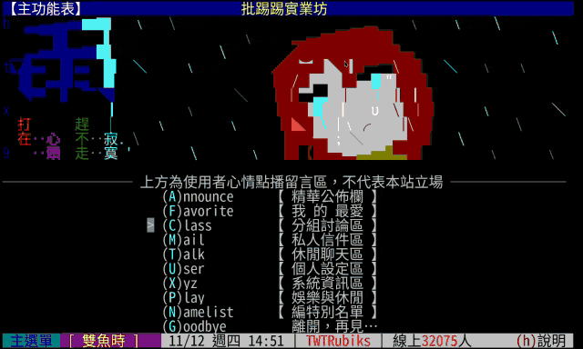

<p align="center">
  
</p>

# ptt-desktop

[](https://github.com/twtrubiks/ptt-desktop/actions/workflows/ci.yml)
[](https://gpui.rs)
[](https://www.rust-lang.org/)

輕量的 PTT 桌面客戶端，以 [GPUI](https://gpui.rs)（Zed 的 GPU 加速 UI 框架）全 Rust 寫成。
保留原汁原味的 80×24 BBS 終端畫面，透過 PTT 官方 WebSocket 端點 `wss://ws.ptt.cc/bbs` 連線。
單一執行檔，不帶 WebView。目前只支援 Linux。


> **舊版（Tauri 2 + xterm.js，支援 Linux／macOS／Windows）**
> 原始碼在 [`tauri` 分支](https://github.com/twtrubiks/ptt-desktop/tree/tauri)，
> 安裝檔在 [v0.1.7 Release](https://github.com/twtrubiks/ptt-desktop/releases/tag/v0.1.7)。
> 兩版共用同一份設定檔；差異與實測數字見 [比較文件](docs/comparison.md)。

## 特色

- **原汁原味**：固定 80×24 字元格、完整 ANSI 色彩與閃爍字；雙色字、彩繪方塊無縫。
  視窗縮放只調字級，文字不會重新斷行
- **輕、快**：閒置記憶體約 45 MB、AppImage 約 7.7 MB，按鍵到畫面更新約 10～18 ms
- **自動登入**：帳密寫在設定檔即自動登入到主功能表；任一步異常立即交還手動，
  絕不自動重試（避免鎖帳號）
- **不怕 PTT 介面改版**：只照實顯示伺服器送來的畫面，不解析版面；
  會受影響的主要是自動登入，壞了也只是退回手動登入
- **自訂快捷鍵**：按鍵 → 送出序列，例如按 `F3` 直跳八卦板
- **防閒置踢出**：每 60 秒送 telnet NOP 保持連線
- **重連有節流**：斷線後按 Enter 重連並重跑自動登入，30 秒內不重複登入
- **網址好點**：網址常駐底線、點擊用系統瀏覽器開啟；圖片連結滑鼠停留浮動預覽，動畫 GIF 會播放

## 操作示範



## 安裝

到 [Releases](https://github.com/twtrubiks/ptt-desktop/releases/latest) 下載 AppImage（x86_64）：

```bash
chmod +x ptt-gpui-*.AppImage && ./ptt-gpui-*.AppImage
```

AppImage 只包執行檔，系統需要 `libssl3`、`libxkbcommon-x11-0`、Vulkan 驅動
（`mesa-vulkan-drivers`）與 Noto Sans Mono CJK TC 字型（`fonts-noto-cjk`）。

## 從原始碼建置

系統需求（Debian／Ubuntu）：Rust toolchain、上述的 Vulkan 驅動與字型，以及

```bash
sudo apt install libxkbcommon-dev libxkbcommon-x11-dev libwayland-dev libx11-dev \
  libfontconfig1-dev libfreetype-dev libssl-dev
```

```bash
cargo run --release      # 第一次要編 gpui 全部依賴，約數分鐘
```

### 打包 AppImage

```bash
APPIMAGETOOL=/path/to/appimagetool RUNTIME=/path/to/runtime-x86_64 scripts/build-appimage.sh
# 產物：target/appimage/ptt-gpui-<版本>-x86_64.AppImage
```

`appimagetool` 與 `runtime-x86_64` 從 GitHub 的 AppImage/appimagetool 與 AppImage/type2-runtime 下載
（沒有 FUSE 時的用法見腳本檔頭）。推送 `v*` tag 時，GitHub Actions 會用同一支腳本建置並建立
draft Release。

## 設定檔

設定檔是選用的：沒有它也能用，只是每次要手動登入。
位置在 `~/.config/ptt-desktop/config.json`，範本見 [`config.example.json`](config.example.json)：

```bash
mkdir -p ~/.config/ptt-desktop
cp config.example.json ~/.config/ptt-desktop/config.json
chmod 600 ~/.config/ptt-desktop/config.json   # 密碼為明文，務必收緊權限
```

| 欄位 | 預設 | 說明 |
|---|---|---|
| `username` / `password` | 空 | PTT 帳密；留空則跳過自動登入，全手動 |
| `kickOtherLogins` | `"y"` | 「您想刪除其他重複登入的連線嗎」的回答。`y` 踢掉同帳號的其他連線；手機與電腦常同時登入者改 `n` |
| `fontFamily` | `"Noto Sans Mono CJK TC"` | 終端字型（系統字型）。沿用舊版設定檔的人請把 `"PTT Square Mono"` 改掉或刪除此欄 |
| `lineHeight` | `1` | 行高倍率，範圍 1–2。`1` 時彩繪方塊完全無縫；調高則列間露縫 |
| `hotkeys` | `{}` | 按鍵 → 送出序列，如 `"F3": "sgossiping\r"`。按鍵名稱使用 [KeyboardEvent.key](https://developer.mozilla.org/en-US/docs/Web/API/KeyboardEvent/key) 值 |

字級由視窗大小決定，舊版的 `fontSize` 欄位會被忽略。

## 操作

| 操作 | 行為 |
|---|---|
| 滑鼠拖曳選取 | 放開即複製到剪貼簿 |
| `Ctrl+Shift+C`／`Ctrl+Shift+V` | 複製／貼上（`Ctrl+C`／`Ctrl+V` 仍是送給 PTT 的控制碼）；滑鼠中鍵貼上選取內容 |
| 滑鼠滾輪 | 一格送一次 ↑／↓ |
| 點擊網址 | 用系統瀏覽器開啟 |
| 滑鼠停在圖片連結 | 浮動預覽（直連 jpg／png／gif／webp 或 imgur 單圖頁），移開即消失 |
| `Ctrl+R` | 重連。連線中要在 3 秒內按兩次；距上次連線不到 30 秒會顯示剩餘秒數 |
| `Enter`（斷線後） | 重連，同樣受 30 秒限制 |
| `F11` | 全螢幕 |
| 關視窗 | 先正常關閉連線再結束（最多 3 秒）。這不是登出 PTT，要離站請在主選單按 g |

自動登入進行中按任何鍵即停止自動登入，改為手動操作（密碼已通過時不另外提示）。
`Ctrl+R` 與 `F11` 優先於自訂快捷鍵。

## 帳密安全

- **只存在本機**：帳密只寫在你自己的設定檔，程式不另外保存、不寫進 log，也沒有任何統計或回報功能
- **只送到 PTT 官方端點**：帳密只經由 `wss://ws.ptt.cc/bbs` 送出，不經過任何第三方伺服器
- **不想存密碼也能用**：`password` 留空（或不建設定檔）就跳過自動登入
- **原始碼可查**：讀設定檔在 [`src/config.rs`](src/config.rs)、登入流程在
  [`src/auto_login.rs`](src/auto_login.rs)、連線在 [`src/net.rs`](src/net.rs)

## 已知限制

- **GPU 用量偏高**：gpui 0.2.2 在輸入後 1 秒內每幀都重畫，閒置時也讓 GPU 進不了省電狀態，
  對筆電續航不利。上游已修正但尚未在 crates.io 發版，目前等上游；詳見
  [比較文件](docs/comparison.md#gpu-問題的上游狀態)
- 只支援 Linux，需要可用的 Vulkan 驅動（沒有 OpenGL 或軟體繪製後備）
- 密碼以明文存於設定檔，請 `chmod 600`
- 被 80 欄硬換行切開的網址無法點擊
- 圖片預覽下載上限一般圖 8 MB、GIF 20 MB；GIF 解碼後超過 128 MB 只顯示第一格
- 重連的 30 秒冷卻只存在記憶體，關掉 app 再開不受限制

## 開發

```bash
cargo run                 # 開發模式
cargo test                # 單元測試（含 tests/fixtures 的實錄重放）
cargo fmt --check && cargo clippy --all-targets -- -D warnings
PTT_LOG=info cargo run    # 印內部 log（不含帳密與畫面內容）
```

- [架構文件](docs/architecture.md)：模組、資料流、協定與各項行為的理由
- [比較文件](docs/comparison.md)：與舊版的差異、實測數字、GPU 問題的上游狀態
- [Harness 使用說明](docs/harness-guide.md)：本專案用 Claude Code 開發的固定流程
  （`/harness-plan` 規劃 → `/harness-work` 實作與審查 → `/harness-review` 獨立審查）

## License

[GPL-3.0](LICENSE)

## Donation

文章都是我自己研究內化後原創，如果有幫助到您，也想鼓勵我的話，歡迎請我喝一杯咖啡 :laughing:

綠界科技ECPAY ( 不需註冊會員 )


[贊助者付款](http://bit.ly/2F7Jrha)

歐付寶 ( 需註冊會員 )


[贊助者付款](https://payment.opay.tw/Broadcaster/Donate/9E47FDEF85ABE383A0F5FC6A218606F8)

## 贊助名單

[贊助名單](https://github.com/twtrubiks/Thank-you-for-donate)
