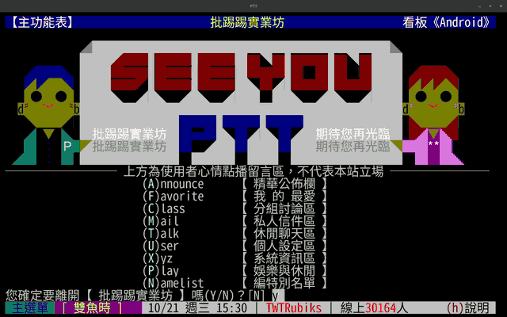

<p align="center">
  
</p>

# ptt-desktop

[](https://github.com/twtrubiks/ptt-desktop/actions/workflows/ci.yml)
[](https://github.com/twtrubiks/ptt-desktop/releases)
[](https://tauri.app/)
[](https://xtermjs.org/)
[](https://www.typescriptlang.org/)
[](https://www.rust-lang.org/)

輕量的 PTT 桌面客戶端（Tauri 2 + xterm.js），保留原汁原味的 80×24 BBS
終端畫面，透過 PTT 官方 WebSocket 端點 `wss://ws.ptt.cc/bbs` 連線。
支援 Linux / macOS / Windows。


## 特色

- **原汁原味**：固定 80×24 字元格、完整 ANSI 色彩，不重新排版；
  視窗縮放只調字型大小，文字不會重新斷行
- **自動登入**：帳密寫在設定檔即自動登入到主功能表；
  任一步異常（密碼不對、逾時）立即交還手動，絕不自動重試（避免鎖帳號）
- **不怕 PTT 介面改版**：只照實顯示伺服器送來的畫面，不解析、不改寫版面，
  選單或版面改了照常顯示；會受影響的主要是自動登入（比對登入提示），
  壞了也只是退回手動登入
- **自訂快捷鍵**：按鍵 → 送出序列，例如按 `F3` 直跳八卦板
- **防閒置踢出**：每 60 秒送 telnet NOP 保持連線
- **斷線重連**：斷線後按 Enter 即重連並重跑自動登入
- **網址好點**：文章內網址常駐底線、點擊用系統瀏覽器開啟、
  圖片連結滑鼠停留浮動預覽（支援直連圖檔）
- **簽名檔閃爍字**：補上 xterm.js 未實作的 ANSI 閃爍動畫

## 操作示範



## 下載安裝

到 [Releases](https://github.com/twtrubiks/ptt-desktop/releases) 下載對應平台的安裝檔：

| 平台 | 檔案 | 備註 |
|---|---|---|
| Linux | `.AppImage` / `.deb` / `.rpm` | AppImage 需先 `chmod +x`；若 Wayland 下畫面異常，可退回 `GDK_BACKEND=x11 ./xxx.AppImage` 執行（此模式下中文輸入不可用） |
| macOS | `.dmg`（universal） | 未經 Apple 公證，首次開啟請對 App 按右鍵 →「打開」，或執行 `xattr -cr "/Applications/ptt-desktop.app"` |
| Windows | `.msi` / `.exe` | 未簽章，SmartScreen 警告時點「更多資訊」→「仍要執行」 |

## 設定檔

設定檔是選用的：沒有它也能用，只是每次要手動登入。
位置在 `~/.config/ptt-desktop/config.json`，範本見 [`config.example.json`](config.example.json)：

```bash
mkdir -p ~/.config/ptt-desktop
cp config.example.json ~/.config/ptt-desktop/config.json
chmod 600 ~/.config/ptt-desktop/config.json   # 密碼為明文，務必收緊權限
```

### 欄位

| 欄位 | 預設 | 說明 |
|---|---|---|
| `username` / `password` | 空 | PTT 帳密；留空則跳過自動登入，全手動 |
| `kickOtherLogins` | `"n"` | 「您想刪除其他重複登入的連線嗎」的回答 |
| `fontFamily` | `"PTT Square Mono"` | 終端字型。預設為 app 內建、彩繪比例已修正的等寬字型；可改用系統字型，但彩繪會回到縱向拉長 |
| `fontSize` | `18` | 終端字級 |
| `lineHeight` | `1` | 行高倍率，範圍 1–2（超出自動夾住）；覺得字擠可調 `1.08`，取捨見 [已知限制](#已知限制) |
| `hotkeys` | `{}` | 按鍵 → 送出序列，如 `"F3": "sgossiping\r"` 直跳八卦板 |

### 快捷鍵

`hotkeys` 的按鍵名稱使用 [KeyboardEvent.key](https://developer.mozilla.org/en-US/docs/Web/API/KeyboardEvent/key) 值。

以下為保留的本地鍵，優先於自訂快捷鍵，不會送給 PTT：

| 按鍵 | 功能 |
|---|---|
| `Ctrl+R` | 手動重連 |
| `F11` | 全螢幕切換 |

## 帳密安全

- **只存在本機**：帳密只寫在你自己的 `~/.config/ptt-desktop/config.json`，
  程式不另外保存、不寫進 log，也沒有任何統計或回報功能
- **只送到 PTT 官方端點**：自動登入時，帳密只經由 PTT 官方 WebSocket 端點
  `wss://ws.ptt.cc/bbs` 送出，不經過任何第三方伺服器
- **不想存密碼也能用**：`password` 留空（或乾脆不建設定檔）就跳過自動登入，
  連線後自己輸入帳密即可
- **原始碼可查**：讀設定檔在 [`src/config.ts`](src/config.ts)、登入流程在
  [`src/auto-login.ts`](src/auto-login.ts)、連線在 [`src/connection.ts`](src/connection.ts)

密碼在設定檔中為明文，請務必照 [設定檔](#設定檔) 一節的指令 `chmod 600`。

## 已知限制

- 密碼以明文存於設定檔，請 `chmod 600`
- 畫面縱向拉長、彩繪方塊變長方形：多半是 `fontFamily` 改成了系統字型，
  改回 `"PTT Square Mono"`（或刪除該欄位）即可
- 行距與彩繪無縫無法兼顧：預設 `lineHeight` 為 `1`（彩繪方塊完全無縫的正方格）；
  覺得長文字太擠可調 `1.08`（行距有感、橫縫幾乎看不出），想更寬鬆可往
  `1.15`～`1.2`，代價是彩繪列間橫縫按比例變明顯
- 被 80 欄硬換行切開的網址無法點擊
- 實心色塊彩繪的拼接處有細黑縫（刻意取捨）：WebGL renderer 能消除，
  但瀏覽一段時間後會亂碼，故維持 DOM renderer

根因與彩繪各項修正細節見 [架構文件](docs/architecture.md)。

## 設計目標：輕量、快

這個專案的首要目標是輕量與快，作法都可以在程式碼裡驗證：

- **系統 WebView**：Tauri 2 使用系統內建 WebView，不像 Electron 打包整個 Chromium
- **沒有前端框架**：純 TypeScript + xterm.js；Rust 側僅 plugin 註冊樣板，不含業務邏輯
- **不做多餘的事**：固定 80×24、`scrollback: 0`；閃爍動畫只在畫面上有
  閃爍字且視窗可見時才跑 timer，其餘時間完全靜止

### 連線路徑與效能

本程式並非原生 telnet / SSH 直連，資料會經過幾層轉手：

```
PTT 主機
  → PTT 官方 WebSocket 閘道 wss://ws.ptt.cc/bbs
  → Rust（tauri-plugin-websocket）
  → IPC → TypeScript 處理（telnet 過濾、Big5/UTF-8 解碼、彩繪修正）
  → xterm.js 在系統 WebView 內繪製
```

| 連線方式 | 中間層 | 繪製 |
|---|---|---|
| 原生客戶端（終端機 `ssh`、PCMan 等） | 最少，直連 BBS | 原生終端機 |
| 官方網頁版 term.ptt.cc | WebSocket 閘道 + 瀏覽器 | 瀏覽器 |
| ptt-desktop | WebSocket 閘道 + Rust + IPC + TypeScript 處理 | 系統 WebView |

層數不少，用起來仍然流暢，原因是：

- **時間主要花在網路**：一次網路往返從幾毫秒到上百毫秒（視離台灣遠近），
  本機各層每次只處理幾 KB 資料，相比之下可以忽略
- **刻意輕量**：即上述設計目標
- **沒有瀏覽器負擔**：不必和其他分頁、擴充功能搶資源

所以與 term.ptt.cc 相比，網路速度相同（走同一個官方端點），差別在獨立的桌面程式
與 [特色](#特色) 列出的功能；與原生客戶端相比，理論上層數較多，但體感分不出差異。
完整資料流見 [架構文件](docs/architecture.md)。

## 開發

系統需求：Node.js 24、Rust toolchain；Linux 另需 webkit2gtk-4.1
（其餘系統依賴見 [`.github/workflows/release.yml`](.github/workflows/release.yml)）。

```bash
npm install
npm run tauri dev    # 開發模式（首次會編譯 Rust，較久）
npm test             # vitest 單元測試
npm run quality      # format / lint / stylelint / clippy 全套檢查
npm run tauri build  # 打包
```

架構與實作細節（WebSocket 端點、telnet 濾層、Big5→UTF-8 切換、
自動登入狀態機、overlay 渲染）見 [架構文件](docs/architecture.md)。

### AI 開發流程（Harness）

本專案用 Claude Code 開發，工作流固定在 `.claude/`：

1. `/harness-plan`：把需求拆成 `Plans.md` 任務
2. `/harness-work`：一次做一個任務
   - 實作後跑 preflight（quality / build / test）
   - 交給獨立的唯讀 reviewer 審查，退件就修完再審，通過才 commit（不 push）

另有 `/harness-review` 可隨時單獨審查。

reviewer 依 checklist 逐條把關，共七類，重點包括：

- **安全 invariant**：自動登入絕不重試、帳密不進 log 與 repo
- **輕量**：不加依賴（除非理由充分）、不引入前端框架
- **其餘**：協定與編碼正確性、架構紀律、測試品質、TS 品質、文件同步

完整說明見 [Harness 使用說明](docs/harness-guide.md)。

## License

[GPL-3.0](LICENSE)

## Donation

文章都是我自己研究內化後原創，如果有幫助到您，也想鼓勵我的話，歡迎請我喝一杯咖啡 :laughing:

綠界科技ECPAY ( 不需註冊會員 )


[贊助者付款](http://bit.ly/2F7Jrha)

歐付寶 ( 需註冊會員 )


[贊助者付款](https://payment.opay.tw/Broadcaster/Donate/9E47FDEF85ABE383A0F5FC6A218606F8)

## 贊助名單

[贊助名單](https://github.com/twtrubiks/Thank-you-for-donate)
